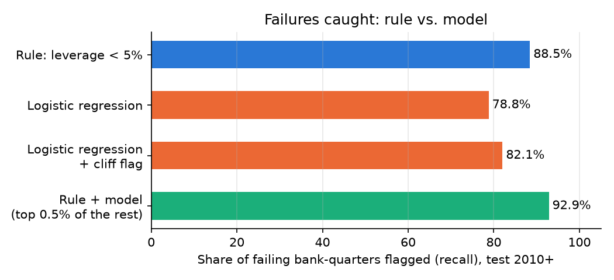

# FDIC Bank Distress Early-Warning System

Predicts which US banks will fail or need an assisted exit within the next 12 months using 25 years of public FDIC quarterly reports (2001-2026). 

async API ingest => DuckDB => dbt => model => watch list

Headline result : a one line regulatory rule (leverage below 5%) already catches 88,5% of failing bank-quarters and logistic regression does not beat it on its own. Its real value is as a second net: among banks that still look fine on capital, the model finds 38% of the failures the rule misses with x77 lift over random selection. Rule and model together catch 92,9% of failing bank quarters.

## Results

Test period: 2010-2025 (362 408 bank quarters, 1 109 positives). The model is trained on 2001-2008 only.

### Rule vs model at the same workload (3,706 flagged bank quarters)

| Method | Failures caught | Recall | Precision |
|---|---|---|---|
| **Rule: leverage < 5%** | **981** | **88.5%** | **26.5%** |
| Logistic regression (15 inputs) | 874 | 78.8% | 23.6% |
| Logistic regression + "cliff" flag (leverage < 5%) | 910 | 82.1% | 24.6% |

Random selection at this workload would be right 0.3% of the time  so the rule is about x70 better than random

### How early each method catches a failure

| Quarters before failure | Failures | Rule | Model |
|---|---|---|---|
| 1 (last report) | 335 | 95.8% | 88.1% |
| 2 | 294 | 93.5% | 83.0% |
| 3 | 254 | 85.4% | 79.9% |
| 4 (a full year ahead) | 226 | 74.3% | 74.3% |

The rule is as good or better at every horizon. 3 in 4 failing banks were already below 5% leverage a year before closing.

### Second net: the model on banks the rule cannot flag (leverage >= 5%)

Of the 1 109 failing bank-quarters, 128 had leverage at or above 5%.

| Extra visits (share of these banks) | Failures found | Found, % of 128 | Precision | Lift vs. random |
|---|---|---|---|---|
| 896 (0.25%) | 36 | 28.1% | 4.02% | x113 |
| **1 793 (0.5%)** | **49** | **38.3%** | **2.73%** | **x77** |
| 3 587 (1%) | 57 | 44.5% | 1.59% | x45 |
| 7 174 (2%) | 65 | 50.8% | 0.91% | x25 |

Returns diminish quickly after 0.5%. The recommended system is the rule plus the model's top 0.5%: 5 499 visits, 1 030 of 1 109 failures (92.9%), against 88.5% for the rule alone.

### What drives the model

Standardized logistic regression weights (+ = more risk). Leverage dominates. Capital structure and asset quality features follow and the signs match banking intuition:

| Feature | Weight |
|---|---|
| leverage ratio | -2.20 |
| leverage below 5% (flag) | +0.91 |
| core deposits / assets | -0.46 |
| nonperforming assets / assets | +0.37 |
| construction loan concentration | +0.28 |
| ROA | -0.26 |
| brokered deposits / deposits | +0.20 |

### Charts




---

## Today's watch list (2026-06-30 reports)

Each quarter the project produces a short list of banks for supervisors to review: banks below the 5% capital line (the rule), plus the riskiest 0.5% of banks the rule considers safe (the model). Every bank gets a top_driver, the feature that pushes its risk up the most, with a direction ("high nonperforming assets", "low core deposits"), so a supervisor knows where to start.

| | Banks |
|---|---|
| Lending banks scored | 4 223 |
| Flagged by the rule (leverage < 5%) | 5 |
| Added by the model (top 0.5% of the rest) | 21 |
| **Watch list** | **26** |

Highest risk: Lamont Bank of St. John (WA): leverage 2.95% and high nonperforming assets, model risk 44%. Some rule-flagged banks score low on the model (under 1%): their capital is thin, but profitability, deposits and asset quality look healthy.

Full list: [`reports/watchlist_latest.csv`](reports/watchlist_latest.csv). Being on the list means "review this bank", not "this bank will fail": in back-testing, most flagged banks survived.


---

## Data decisions

Most of the work in this project went into finding and handling these issues:

| Issue | Evidence | Decision |
|---|---|---|
| **Defining an exit.** History holds every structural event, and the bank that ended is not always in `cert`. | Exit analyses | Use only the institution's own rows (`org_role = FI`); the bank that ended = `coalesce(outgoing_cert, cert)`; change codes classified in a seed; earliest exit wins, ties broken by severity. |
| **Code 224 misclassified.** Affiliated-bank merger (a corporate reorganization) was labeled "assisted". | 195 banks | Reclassified as ordinary. Assisted exits: 1018 => 823. |
| **Credit unions in FDIC history.** Code 260 failures are mostly NCUA credit unions, which aren't FDIC banks. 2550 failure exits have no FDIC institution record; 2510 of them are code 260 | Kept in the seed. They have no financials, so they drop out at the spine join. |
| **Censored labels.** The last 4 quarters' 12-month windows aren't finished. | 17529 rows | Label = null, cutoff computed from the latest report date (not today's date). Excluded from training. |
| **Gap year.** 2008 rows' labels depend on 2009 outcomes. | - | Train <= 2008, test >= 2010; 2009 unused. |
| **Leakage.** Exit dates are the answer. | - | Exit information is used only in the labels model and for grading lead time, never as a feature. Trends use `lag(…, 4)` only when the lagged report is exactly 12 months earlier; no forward-looking windows. |
| **CBLR: risk-based capital "0".** Since 2020, community banks using the Community Bank Leverage Ratio stop reporting risk-based ratios. | 17-23 banks/yr with 0 before 2020, ~1,800-2,100 after | 0 or CBLR flag => null. Excluded from model features (train/test shift); leverage used instead. A test guards against the zeros coming back. |
| **Leverage "0" = not reported.** | 25 institutions in training years, 0 failures; mostly insured US branches of foreign banks (classes OI/NC), which hold no separate capital | 0 => null, with a test. Removed ~1000 false alarms from the rule. |
| **Non-lending institutions.** Trust companies and similar: ratios on loans are undefined. | 12233 zero-loan rows, 1 positive | Excluded from the training mart by a row-level rule (`gross_loans > 0` in that quarter), so no future information is used. |
| **Negative capital.** | 172 rows, 79% labeled 1 | Kept: these are insolvent banks, the strongest signal in the data. |
| **Outliers.** | - | Clipped at train 0.1% / 99.9%. At 1% / 99%, clipping erased the weakest banks' leverage signal. |
| **Parquet schema drift.** An all-null column was written with type NULL in early files. | `OTBFH1L` | Sources read with `union_by_name=true`. Proper fix (fixed schema at ingest) listed below. |


---

## Modeling choices

- **Unit:** one bank-quarter. **Label:** failure or assisted exit within 12 months of the report date. **Population:** lending banks with labeled windows.
- **Preprocessing:** median fill, 0.1/99.9% clipping, standardization. Every statistic is learned on train and applied unchanged to test and to today's data.
- **Features (14 + 2 flags):** asset quality (nonperforming assets, loan-loss allowance, construction concentration), earnings (ROA, net interest margin, efficiency), funding (brokered, core, FHLB), capital (leverage), four-quarter trends of core deposits, nonperforming assets, ROA and leverage, plus `is_first_year` and `leverage_below_5_prc`.
- **Evaluation:** equal-workload comparison against the baseline (accuracy is meaningless at a 0.3% positive rate), recall by quarters before failure, and lift on the cases the rule cannot see.

---

## Repository structure

```
src/                 async FDIC API ingest (config, sources, fields, main)
data/raw/            Parquet + raw JSON per source (not committed)
data/fdic.duckdb     DuckDB database (not committed)
fdic_ews/            dbt project: models/, seeds/, macros/, analyses/, tests
notebooks/           01_model.ipynb – model, evaluation, watch list
reports/             watchlist_latest.csv, figures/ (3 charts)
```

---

*Data: FDIC BankFind Suite API (public). Not affiliated with the FDIC. For personal project purposes, not supervisory advice.*
