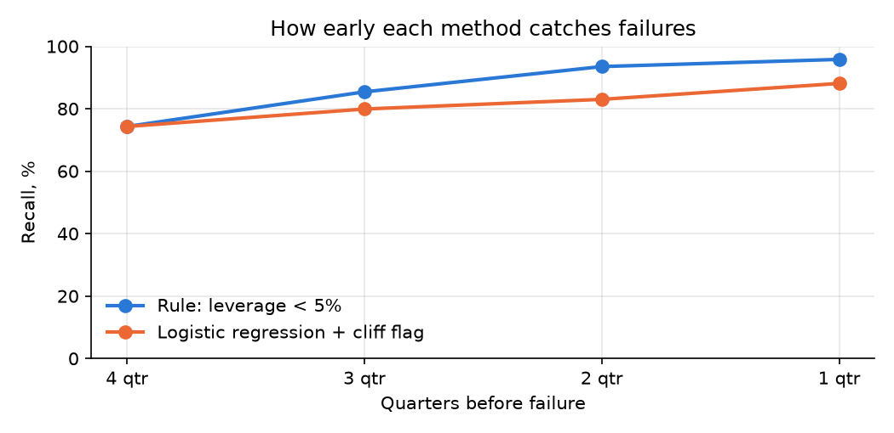
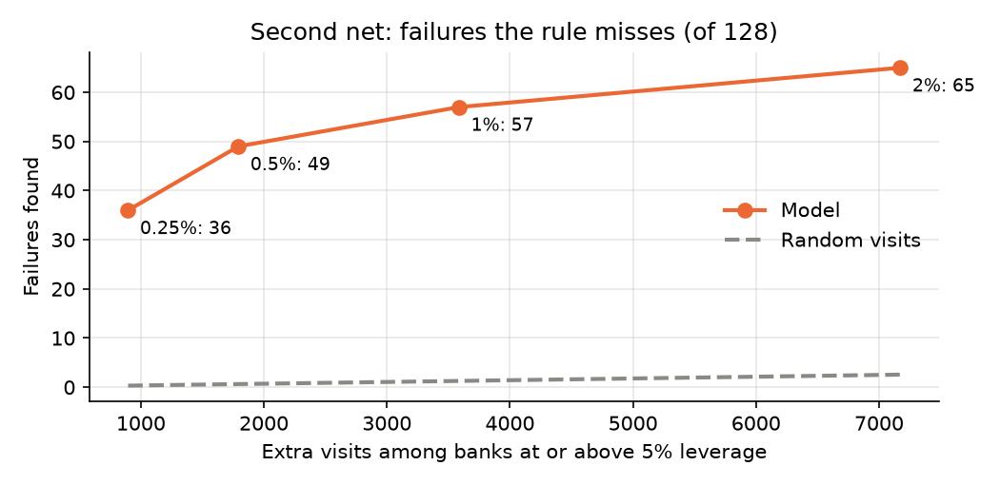

# FDIC Bank Distress Early-Warning System

Predicts which US banks will fail or need an assisted exit within the next 12 months using 25 years of public FDIC quarterly reports (2001–2026). 

async API ingest => DuckDB => dbt => model => watch list

Headline result : a one line regulatory rule (leverage below 5%) already catches 88,5% of failing bank-quarters and logistic regression does not beat it on its own. Its real value is as a second net: among banks that still look fine on capital, the model finds 38% of the failures the rule misses with x77 lift over random selection. Rule and model together catch 92,9% of failing bank quarters.

## Results

Test period: 2010–2025 (362 408 bank quarters, 1 109 positives). The model is trained on 2001–2008 only.

### Rule vs model at the same workload (3,706 flagged bank quarters)

| Method | Failures caught | Recall | Precision |
|---|---|---|---|
| **Rule: leverage < 5%** | **981** | **88.5%** | **26.5%** |
| Logistic regression (15 inputs) | 874 | 78.8% | 23.6% |
| Logistic regression + "cliff" flag (leverage < 5%) | 910 | 82.1% | 24.6% |

Random selection at this workload would be right 0.3% of the time  so the rule is about x70 better than random

### How early each method catches a failure

| Quarters before failure | Failures | Rule | Model |
|---|---|---|---|
| 1 (last report) | 335 | 95.8% | 88.1% |
| 2 | 294 | 93.5% | 83.0% |
| 3 | 254 | 85.4% | 79.9% |
| 4 (a full year ahead) | 226 | 74.3% | 74.3% |

The rule is as good or better at every horizon. 3 in 4 failing banks were already below 5% leverage a year before closing.

### Second net: the model on banks the rule cannot flag (leverage >= 5%)

Of the 1 109 failing bank-quarters, 128 had leverage at or above 5%.

| Extra visits (share of these banks) | Failures found | Found, % of 128 | Precision | Lift vs. random |
|---|---|---|---|---|
| 896 (0.25%) | 36 | 28.1% | 4.02% | x113 |
| **1,793 (0.5%)** | **49** | **38.3%** | **2.73%** | **x77** |
| 3,587 (1%) | 57 | 44.5% | 1.59% | x45 |
| 7,174 (2%) | 65 | 50.8% | 0.91% | x25 |

Returns diminish quickly after 0.5%. The recommended system is the rule plus the model's top 0.5%: 5 499 visits, 1 030 of 1 109 failures (92.9%), against 88.5% for the rule alone.

### What drives the model

Standardized logistic regression weights (+ = more risk). Leverage dominates. Capital structure and asset quality features follow and the signs match banking intuition:

| Feature | Weight |
|---|---|
| leverage ratio | -2.20 |
| leverage below 5% (flag) | +0.91 |
| core deposits / assets | -0.46 |
| nonperforming assets / assets | +0.37 |
| construction loan concentration | +0.28 |
| ROA | -0.26 |
| brokered deposits / deposits | +0.20 |

### Charts

---

## Today's watch list (2026-06-30 reports)

Each quarter the project produces a short list of banks for supervisors to review: banks below the 5% capital line (the rule), plus the riskiest 0.5% of banks the rule considers safe (the model). Every bank gets a top_driver, the feature that pushes its risk up the most, with a direction ("high nonperforming assets", "low core deposits"), so a supervisor knows where to start.

| | Banks |
|---|---|
| Lending banks scored | 4 223 |
| Flagged by the rule (leverage < 5%) | 5 |
| Added by the model (top 0.5% of the rest) | 21 |
| **Watch list** | **26** |

Highest risk: Lamont Bank of St. John (WA): leverage 2.95% and high nonperforming assets, model risk 44%. Some rule-flagged banks score low on the model (under 1%): their capital is thin, but profitability, deposits and asset quality look healthy.

Full list: [`reports/watchlist_latest.csv`](reports/watchlist_latest.csv). Being on the list means "review this bank", not "this bank will fail": in back-testing, most flagged banks survived.

